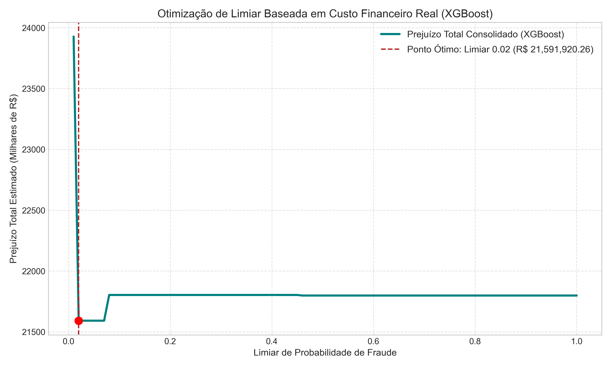
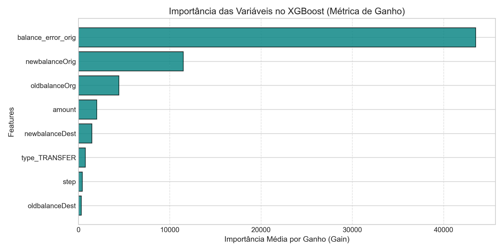

# Detecção de Fraudes Financeiras com XGBoost e Otimização de Limiar por Função de Custo

Este projeto implementa uma esteira completa de detecção de fraudes financeiras com foco em **redução de perdas reais de capital** sobre o conjunto de dados PaySim (~2,7 milhões de transações relevantes).

A solução substitui a clássica abordagem de árvores de decisão simples por um modelo de gradiente boosting (**XGBoost**) combinado com calibração contínua de limiares guiada por impacto financeiro real: custo operacional de atrito por Falso Positivo versus volume em reais perdido em Falsos Negativos.

---

## 📌 Principais Resultados do Projeto

* **Redução de 97,02% no prejuízo total:** De **R$ 21.798.667,35** (na árvore de decisão única) para **R$ 648.975,18** no XGBoost com limiar financeiramente ótimo.
* **Economia líquida gerada:** Mais de **R$ 21,14 milhões recuperados** na carteira de crédito/transferências.
* **Calibração da Fronteira de Decisão:** O limiar ótimo de corte foi identificado em **0.08** (8% de probabilidade de risco), capturando 99,81% das fraudes com apenas 171 alertas para revisão operacional.
* **ROI Operacional:** Para cada R$ 1,00 incremental gasto em verificação operacional (R$ 50,00 por alarme falso), foram recuperados **mais de R$ 113,00** em fraudes evitadas.

---

## 📊 Comparativo Evolutivo da Esteira

| Modelo / Abordagem | Limiar de Corte | Falsos Positivos (FP) | Custo Operacional FP (R$) | Fraudes Perdidas (FN) | Prejuízo com Fraudes (R$) | Prejuízo Financeiro Total |
| :--- | :---: | :---: | :---: | :---: | :---: | :---: |
| **Árvore de Decisão Simples** | 0.50 | 1 | R$ 50,00 | 8 | R$ 21.798.617,35 | **R$ 21.798.667,35** |
| **XGBoost (Baseline)** | 0.50 | 37 | R$ 1.850,00 | 5 | R$ 1.399.572,27 | **R$ 1.401.422,27** |
| **XGBoost (Otimizado por Custo)** | **0.08** | **171** | **R$ 8.550,00** | **3** | **R$ 640.425,18** | **R$ 648.975,18** |

---

## 📈 Visualizações do Modelo

### 1. Curva de Otimização Financeira do Limiar
A curva demonstra a assimetria do problema antifraude. Enquanto limiares altos aumentam drasticamente as perdas ao permitir o escape de fraudes vultosas, limiares excessivamente baixos geram custos operacionais desnecessários. O ponto ótimo de mínimo global ocorre em **0.08**.



### 2. Importância das Variáveis (Métrica de Ganho)
A análise de ganho interno do XGBoost confirma que a integridade contábil das contas (`balance_error_orig`) é o vetor primário de separação das fraudes, seguido da evolução do saldo das contas de origem (`newbalanceOrig` e `oldbalanceOrg`).



---

## 🛠️ Arquitetura do Repositório

```text
fraud-detection-cost-optimizer/
│
├── data/                      # Base de dados (armazenar paysim.csv localmente)
│   └── .gitkeep
├── figures/                   # Gráficos da curva de custo e relevância de variáveis
│   ├── curva_custo_otimizada.png
│   └── feature_importance_gain.png
├── notebooks/                 # Notebooks e experimentos exploratórios
├── src/
│   ├── __init__.py
│   └── pipeline_antifraude.py # Script modularizado de pré-processamento, treino e métricas
├── .gitignore                 # Arquivo de exclusão de artefatos pesados e temporários
├── README.md                  # Documentação executiva e técnica do projeto
└── requirements.txt           # Bibliotecas e dependências do ambiente